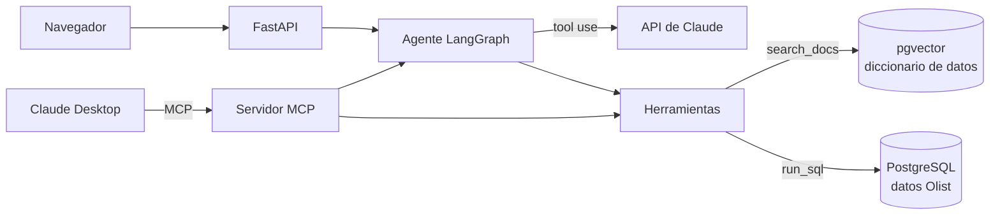
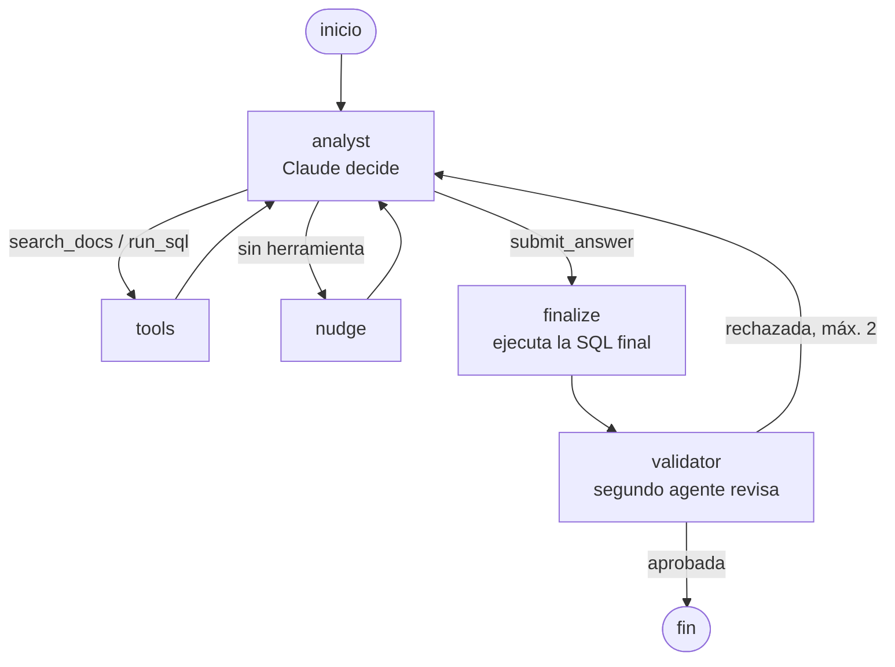

# Agent BI

**Un agente de IA que responde preguntas de negocio en lenguaje natural sobre una base de datos real.** Busca las definiciones del negocio, escribe la consulta SQL, un segundo agente la valida, y responde con el número, un gráfico y la evidencia.

> **Demo en video:** _[link al video]_ · se levanta en local con un solo comando (`docker compose up`)
> **Resultado:** acierta **29 de 30 preguntas (96,7%)** de una evaluación propia, a ~USD 0,05 y ~15 s por pregunta.

<!-- GIF de la demo -->

```
👤 ¿Qué región cayó más en ventas el último trimestre?

🤖 La región Norte, con una caída del 13,3% (Q1 → Q2 2018), de R$ 81,8 mil a R$ 71,0 mil.
   Nordeste también cayó (-4%); el resto creció.
   ✓ Validado · 4 pasos · gráfico de barras · SQL y datos disponibles
```

## Qué hace

- **Preguntas en lenguaje natural** sobre ~100.000 órdenes del e-commerce brasileño [Olist](https://www.kaggle.com/datasets/olistbr/brazilian-ecommerce) (2016–2018).
- **RAG sobre un diccionario de datos:** el agente busca qué significa "ventas", "último trimestre" o "región" antes de escribir SQL. Sin esto, los modelos adivinan y se equivocan en silencio.
- **Agente con herramientas:** decide cuándo buscar documentación y cuándo ejecutar SQL, y corrige solo sus errores de SQL.
- **Validador independiente:** un segundo agente revisa la SQL y el resultado contra la documentación antes de responder.
- **Respuesta completa:** texto, gráfico elegido por el agente (barras, líneas, torta o KPI), datos, SQL y el paso a paso del razonamiento.
- **Tres formas de uso:** web, API REST y **servidor MCP** (Claude Desktop, Cursor, etc.).

## Arquitectura



### El grafo del agente



## Evaluación

30 preguntas propias (10 fáciles, 12 intermedias, 8 difíciles), cada una con su SQL de referencia escrita a mano. La comparación es por **resultados** (*execution accuracy*): cada valor de la respuesta correcta tiene que aparecer en el resultado del agente, con 1% de tolerancia.

| Variante | Modelo | Aciertos | Costo / 30 preguntas | Tiempo promedio |
|---|---|---|---|---|
| **Agente + validador** | Claude Opus 5.5 | **29/30 (96,7%)** | USD 1,56 | 14,7 s |
| Una sola pasada (RAG + SQL) | Claude Opus 5.5 | 29/30 (96,7%) | USD 0,52 | 7,4 s |
| Una sola pasada (RAG + SQL) | Claude Haiku 5.5 | 26/30 (86,7%) | USD 0,02 | 4,0 s |
| Agente + validador | Claude Haiku 5.5 | 23/30 (76,7%) | USD 0,04 | 10,2 s |
| Agente sin validador | Claude Haiku 5.5 | 22/30 (73,3%) | USD 0,04 | 7,4 s |

**Lo que aprendí de los números:**

- **Con un modelo fuerte y buena documentación, una sola pasada ya rinde muy bien.** Las dos variantes con Opus fallan una pregunta, pero distinta. La versión simple falló porque su única búsqueda no trajo la definición de GMV y tuvo que adivinar. El agente resuelve justo ese caso volviendo a buscar. El "error" del agente fue una ambigüedad de mi pregunta de referencia: contó solo órdenes válidas, como dice la documentación, y además aclaró el otro número en su respuesta.
- **Los modelos chicos rinden peor como agentes.** Con Haiku, el agente (73–77%) queda por debajo de la versión simple (87%): planificar solo en un bucle de herramientas le agrega lugares donde equivocarse.
- **Con 30 preguntas, 1 o 2 de diferencia está dentro del ruido.** El validador sumó una pregunta con Haiku, pero no alcanza para afirmar que mejora la precisión. Su valor principal es la trazabilidad: cada respuesta llega revisada y con las observaciones visibles.

Resultados completos por pregunta en [`evals/results/`](evals/results). Para correrlo: `uv run python scripts/run_evals.py --variant graph`.

## Decisiones de diseño

| Decisión | Por qué |
|---|---|
| **Búsqueda híbrida** (pgvector + full-text de Postgres, fusionadas con RRF) | Con solo búsqueda semántica, la definición de "ventas" quedaba en el puesto 11 de 18 para la pregunta principal. Las palabras clave lo resuelven, y los embeddings encuentran sinónimos ("zona del país" → "regiones"). |
| **Diccionario de datos como fuente de verdad** | Las reglas de negocio (qué cuenta como venta, que `customer_id` no es la persona, que unir pagos con ítems duplica montos) no están en el esquema. Escribirlas bien mejoró más que cualquier cambio de prompt. |
| **El LLM elige el gráfico, el código lo dibuja** | El agente devuelve un spec (`tipo`, `x`, `y[]`, `formato`) y la web decide la presentación: barras horizontales con etiquetas largas, rojo para negativos, tarjetas KPI. Es predecible y no se ejecuta código generado. |
| **SDK de Anthropic dentro de LangGraph** | LangGraph orquesta el flujo; las llamadas usan el SDK oficial para tener control total (herramientas `strict`, caché de prompt, fallback ante rechazos). |
| **Seguridad en tres capas** | El código solo acepta `SELECT`, la transacción es de solo lectura con timeout, y en producción la app usa un usuario de Postgres que solo tiene permisos de lectura. |
| **Embeddings locales** (fastembed, multilingüe) | Sin otra API key y gratis. El costo: ~400 MB de RAM por el vocabulario multilingüe, que lo deja fuera de los planes de hosting gratuitos de 512 MB. |

**En un entorno productivo con datos de una empresa,** la app usaría autenticación delegada (OAuth *on-behalf-of*) para que cada usuario vea solo los datos que tiene permitidos, en lugar de una cuenta de servicio compartida.

## Stack

Python 3.12 · Claude (Anthropic SDK) · LangGraph · PostgreSQL + pgvector · fastembed · FastAPI · MCP (Python SDK v2) · Chart.js · Docker · uv

## Correrlo localmente

Requisitos: Docker, [uv](https://docs.astral.sh/uv/) y una [API key de Anthropic](https://console.anthropic.com).

```bash
git clone https://github.com/Matias0DF/agent-bi.git && cd agent-bi
cp .env.example .env                      # completar ANTHROPIC_API_KEY
docker compose up -d db                   # Postgres + pgvector
uv sync
# Descargar el dataset de Kaggle y copiar los CSV a data/raw/
uv run python scripts/load_data.py        # carga las tablas (una sola vez)
uv run python scripts/index_docs.py       # indexa el diccionario de datos
docker compose up -d --build              # base + app
```

Abrir http://localhost:8080. Las próximas veces alcanza con `docker compose up -d`.

Para desarrollo, sin contenedor: `uv run uvicorn agent_bi.api:app --port 8000` (abrir http://localhost:8000). También por consola: `uv run python scripts/ask.py "¿Qué región vendió más en 2017?"`.

**Como servidor MCP** (Claude Desktop → `claude_desktop_config.json`):

```json
{
  "mcpServers": {
    "agent-bi": {
      "command": "uv",
      "args": ["--directory", "/ruta/a/agent-bi", "run", "python", "-m", "agent_bi.mcp_server"]
    }
  }
}
```

## Estructura

```
src/agent_bi/
├── db.py            esquema y ejecución segura de SQL
├── rag.py           embeddings y búsqueda híbrida
├── text_to_sql.py   variante de una sola pasada
├── agent.py         herramientas y bucle del agente (versión manual)
├── graph.py         agente con LangGraph + validador
├── usage.py         tokens y costo por pregunta
├── api.py           API REST (FastAPI)
├── mcp_server.py    servidor MCP
└── web/index.html   interfaz web
docs/data_dictionary.md    conocimiento del negocio (fuente del RAG)
evals/                     preguntas de evaluación y resultados
scripts/                   carga de datos, indexación, consola y evals
```

## Limitaciones y próximos pasos

- El criterio de evaluación es algo permisivo: si el agente devuelve una tabla más grande que contiene la respuesta, cuenta como correcta. Un juez LLM daría una medida más estricta.
- 30 preguntas alcanzan para detectar diferencias grandes, no chicas.
- Ideas pendientes: respuestas en streaming con el progreso real del agente, mapa de Brasil por estado, y trazas con LangSmith.
